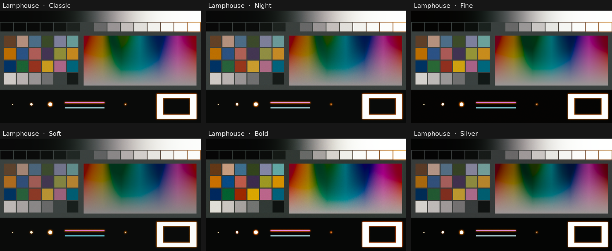
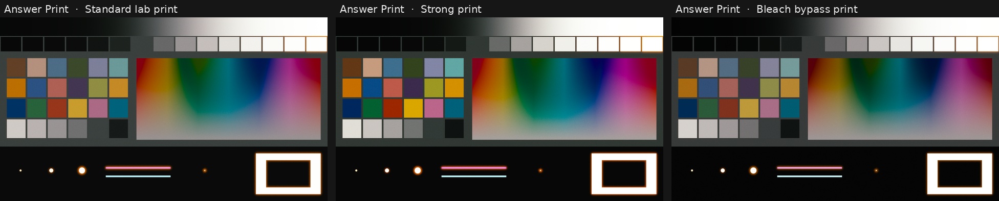
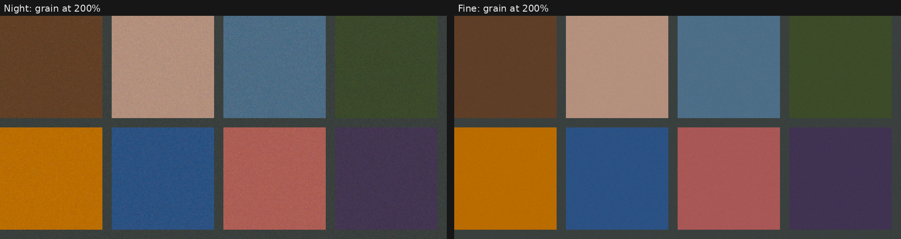
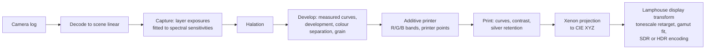

# Lamphouse

**A free display rendering transform (DRT) for DaVinci Resolve, with looks rendered by a physical model of
photochemical film.** Camera log in, finished picture out, in SDR or HDR.

Most DRTs build their look from tone curves and colour adjustments. Lamphouse renders its looks by simulating the
chain a projected film image goes through, using published Kodak datasheet data:

1. Your scene light exposes the three dye layers of a **colour negative**.
2. The negative is developed through its measured **characteristic curves**, including the **interlayer effect**
   that gives colour negative its colour separation.
3. It is printed on an **additive printer** onto **print film**, with colour balance set in real printer points.
4. The print is developed and **projected with a xenon lamp**. The light coming off the screen becomes your image.

Lamphouse then fits that image to your display: Rec.709, sRGB, Display P3, P3-D65, Rec.2100 PQ or HLG, with your
peak luminance, mid grey and viewing surround. Halation and grain happen where they physically would in the chain.

The repo also contains **Answer Print**, the same film rendering as a simpler standalone tool.

## Features

- **A complete DRT:** camera log in (DaVinci WG/Intermediate, ACEScct, ARRI LogC3/LogC4, Sony S-Log3, RED Log3G10,
  Panasonic V-Log), display out in SDR or HDR.
- **Six looks:** Classic, Night, Fine, Soft, Bold and Silver, each a different combination of capture response,
  print base and process, all from the same physics.
- **Every control exposed, in plain language:** override a look's capture response, print base or process, and
  adjust exposure, development, colour separation, brightness, red/green/blue balance, contrast and silver retention.
- **Spectral rendering:** dyes, printer light and projector interact wavelength by wavelength (37 samples,
  380–740 nm), computed on the GPU per pixel.
- **HDR that extends the look rather than re-grading it:** highlights the SDR rendering compresses open up smoothly
  toward your peak (about 980 nits on a 1000-nit display) while the look stays the same.
- **Halation:** the red-orange glow around bright light, sized in microns so it scales correctly with resolution
  and format.
- **Grain:** per-layer, stronger in denser areas, new every frame, consistent from HD to 4K.
- **16, 35 and 65 mm formats.**

## Downloads

| File | What it is |
|---|---|
| [`dctl/Lamphouse.dctl`](dctl/Lamphouse.dctl) | **The DRT.** Camera log in, any display out, six looks, SDR and HDR |
| [`dctl/AnswerPrint.dctl`](dctl/AnswerPrint.dctl) | **Answer Print:** the film rendering on its own, with film terminology, for SDR. DaVinci WG/Intermediate in |

Both render the same film. On a 100-nit Rec.709 display with a dark surround, Lamphouse reproduces Answer Print to
within 0.002 of a code value, halation and grain included.

## Install

1. Download from the [latest release](../../releases/latest).
2. Copy the `.dctl` files into Resolve's LUT folder:
   - **macOS:** `/Library/Application Support/Blackmagic Design/DaVinci Resolve/LUT/`
   - **Windows:** `C:\ProgramData\Blackmagic Design\DaVinci Resolve\Support\LUT\`
   - **Linux:** `/opt/resolve/LUT/`
3. Restart Resolve, or click **Reset** next to the DCTL list in the DCTL plugin.
4. Colour page → **OpenFX → ResolveFX Color → DCTL**, drag it onto the **last node**, and pick the file.

Use the **DCTL plugin**, not "Apply LUT": halation reads neighbouring pixels and grain needs the timeline frame
number, which Resolve only provides through the plugin.

## Using Lamphouse

1. **Input:** set it to your timeline or camera space. DaVinci WG / Intermediate is the default.
2. **Display:** pick your display. For HDR set **HDR Peak Nits**.
3. **Look:** pick one, then shape it with the sliders.
4. Put Lamphouse last and don't add another output transform after it.

With Resolve Color Management, choose **Display: DWG DI for RCM** and set RCM's output **tone mapping** and **gamut
mapping** to **None**. RCM then reproduces Lamphouse exactly on whatever SDR output you choose. For HDR, use the PQ or
HLG options directly in a non-managed project.

### Looks

| Look | Character |
|---|---|
| **Classic** | Clean, balanced daylight rendering. The reference look |
| **Night** | Fast tungsten response: more grain and halation, made for low light |
| **Fine** | Finest grain, deep blacks, crisp colour |
| **Soft** | Fine tungsten response, gentler development, lower contrast |
| **Bold** | Pushed, denser and richer, with a harder print and a touch of retained silver |
| **Silver** | Heavy retained silver: high contrast, muted colour, inky blacks |

### Controls

| Control | What it does |
|---|---|
| **Response** | Override the look's capture response (Fast Tungsten, Daylight, Fine Tungsten, Fine Daylight): spectral sensitivity, tone curve, colour and grain |
| **Print Base** | Override the look's print: Classic, or Deep for denser blacks and more contrast |
| **Process** | Override the look's process: Normal, Strong, or Silver |
| **Exposure** | Exposure into the capture stage, in stops |
| **Development** | Push or pull in stops: contrast and density of the capture stage |
| **Colour Separation** | Interlayer colour effect: more separation between hues, neutrals untouched. 0.3 = calibrated |
| **Brightness** | Overall brightness in printer points (1 point = 0.025 log exposure) |
| **Red / Green / Blue Balance** | Colour balance in printer points. Positive = more of that colour |
| **Contrast** | Print contrast around mid grey |
| **Silver Retention** | Neutral silver left in the image: more contrast, less colour. Brightness compensates to hold mid grey |
| **Halation / Halation Size** | Strength and spread of the glow around bright light |
| **Grain / Grain Size** | Grain strength and size |
| **Format** | 16, 35 or 65 mm: sets halation and grain size relative to the frame |
| **Display** | Rec.709 2.4, sRGB 2.2, Display P3 2.2, P3-D65 2.6, Rec.2100 PQ, Rec.2100 HLG, DWG DI for RCM |
| **HDR Peak Nits** | Peak luminance for PQ and HLG |
| **Mid Grey Nits** | Mid-grey luminance at 100 nits. 10 = reference. Raised automatically for HDR |
| **Surround** | Dark (reference, as in a cinema), Dim or Bright: lower contrast for brighter rooms, mid grey held |

## Answer Print

Answer Print is the film rendering without the display-transform layer, with film terminology throughout:

- Negative: VISION3 500T 5219, 250D 5207, 200T 5213 or 50D 5203.
- Print: 2383 or 2393.
- Print look: standard, strong, or bleach bypass.
- Exposure, push/pull, interlayer, printer lights R/G/B in points, print contrast, bleach bypass, halation, grain
  and gauge.

It takes DaVinci WG / Intermediate and outputs Rec.709 2.4, sRGB, P3-D65 2.6, or DWG/DI for Resolve Color
Management.

Lamphouse's plain-language controls map to these one to one:

| Lamphouse | Answer Print |
|---|---|
| Response: Fast Tungsten / Daylight / Fine Tungsten / Fine Daylight | VISION3 500T / 250D / 200T / 50D |
| Print Base: Classic / Deep | 2383 / 2393 |
| Process: Normal / Strong / Silver | Standard / Strong / Bleach bypass print |
| Development | Push / Pull |
| Colour Separation | Interlayer |
| Brightness, Red/Green/Blue Balance | Print density and printer lights (sign flipped: positive = brighter / more of that colour) |
| Silver Retention | Bleach Bypass |

## How it's built

**The data.** Spectral sensitivities, characteristic curves, spectral dye densities and base densities of four
Kodak VISION3 negatives and two print stocks, from Kodak's technical datasheets as digitized by the open
[spektrafilm](https://github.com/andreavolpato/spektrafilm) project. Light sources: a 3200 K tungsten printer lamp
behind a Schott KG3 heat filter, a Kinoton 75P xenon projector lamp, and the CIE 1931 observer.

**Capture.** A camera has already reduced the spectrum to three numbers, so Lamphouse uses a fitted function per
capture response. It maps scene-linear DaVinci Wide Gamut to the exposure each film layer would receive, fitted by
integrating the spectral sensitivities against about 1,500 realistic surface spectra. Checked against real
ColorChecker spectra it never saw, it is accurate to about 1/6 stop on average, and exact on greys.

**Film.** Negative and print are developed through their measured curves. The negative's dyes, the printer light,
the print's dyes and the projector lamp are combined wavelength by wavelength. Each capture/print combination is
balanced so an 18% grey prints neutral at Kodak's laboratory aim density.

**Display transform.** The film renders a picture as a cinema print looks: 100-nit white, 10-nit grey, dark
surround. Lamphouse takes that picture's luminance through the inverse of its reference tonescale and forward
through a tonescale for your display. At the reference the look is reproduced exactly; on HDR, other grey levels or
surrounds it extends consistently. Hue and saturation ride along unchanged. Colours outside the display gamut are
desaturated toward their own luminance instead of clipped, so hues hold.

**What isn't measured.** Kodak doesn't publish the strength of the interlayer effect, so the default was matched
to the independent spektrafilm simulator. Grain levels follow Kodak's ordering of the stocks but were set by eye,
as was halation.

The full technical write-up, with equations, design decisions and test results:
**[docs/how-it-works.md](docs/how-it-works.md)**.

## Accuracy and testing

| Check | Result |
|---|---|
| Capture stage vs real ColorChecker spectra (held out) | ≈ 0.05 log exposure RMS (about 1/6 stop) |
| Camera log decoding vs colour-science reference curves, 8 input spaces | ≤ 7×10⁻⁶ relative error |
| 10 nm spectral sampling vs 5 nm | ≤ 0.22 ΔE2000 |
| Answer Print DCTL vs the Python reference model, 8 stock pairs | 99% within 0.0025 code value |
| Lamphouse vs Answer Print at the reference display, all looks, halation and grain on | ≤ 0.002 code value |
| HDR (PQ 400 / 1000 / 4000 nits, HLG 1000) | Monotonic, highlights roll into the peak |
| RCM re-encode vs direct Rec.709 | Exact |

## Known limitations

- **Set by eye:** grain level, halation strength and the colour-separation default are tuned rather than measured.
  They're the controls most worth adjusting on real footage.
- **Generic printer:** a typical additive printer, not a specific lab's machine.
- **Capture estimate:** most accurate on everyday surface colours, least on narrow-band lights such as LEDs and neon.
- **HDR on Answer Print:** Answer Print is SDR only. Use Lamphouse for HDR.
- **GPU load:** heavier than a LUT. Halation is the most expensive part; set it to 0 for faster playback.
- **Plugin needed:** applied as a LUT instead of through the DCTL plugin, grain freezes and halation can't sample
  neighbouring pixels.

## Building from source

Both DCTLs are generated from public data by a small Python model in [`build/`](build). See
[build/README.md](build/README.md) to retune or rebuild.

## Credits and licence

- **Lamphouse and Answer Print** by Nico Welgemoed.
- **Film data** derived from [spektrafilm](https://github.com/andreavolpato/spektrafilm) by Andrea Volpato,
  CC BY-SA 4.0, modified by Nico Welgemoed (see [CHANGELOG.txt](CHANGELOG.txt)).

The DCTLs are CC BY-SA 4.0 and the build code is GPLv3; see [LICENSE.md](LICENSE.md). Anything you grade with
Lamphouse or Answer Print is entirely yours, commercial work included.

Kodak, VISION3 and the stock numbers are trademarks of Kodak, used only to identify the stocks emulated. Lamphouse
is not affiliated with or endorsed by Kodak or Andrea Volpato.

## FAQ

**Can I use it on paid jobs?** Yes. The licences cover the files, not your images.

**Can I share or modify it?** Yes. Keep the credits in the file headers and share under the same licence.

**Why does grain not move, or halation not appear?** It has been applied as a LUT. Use the ResolveFX DCTL plugin.

**Lamphouse or Answer Print?** Lamphouse if you want a DRT with HDR and camera inputs. Answer Print if you think in
film stocks and printer lights and deliver SDR.
